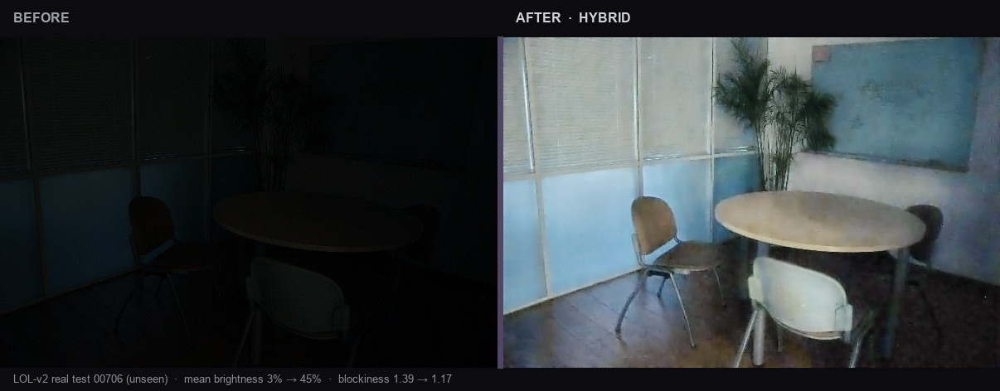
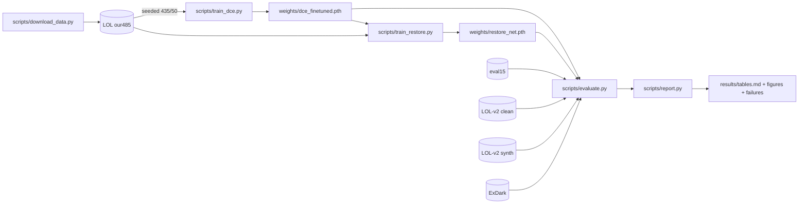

<div align="center">

# LUMINA

### See what the dark hid, without inventing what was not there.

Adaptive low-light image restoration · classical CV + two small networks · CPU only · no generative model

<br/>

<a href="https://lumina-t76.vercel.app"></a>
&nbsp;
<a href="https://darshuuuu-lumina-lowlight.hf.space"></a>
&nbsp;
<a href="https://github.com/darshchandran/lumina-lowlight"></a>

<br/><br/>


<br/><br/>



<sub>
<strong>Before</strong> 3% mean brightness · <strong>After</strong> hybrid 45% · blockiness 1.39 → 1.17 · LOL-v2 real <code>00706</code> (unseen) · residual-only restorer, no generative model
</sub>

<br/><br/>

<a href="#system-architecture"></a>
<a href="#pipeline"></a>
<a href="#results"></a>
<a href="#requirements--code"></a>
<a href="eval_P1_T76.md"></a>
<a href="docs/DESIGN.md"></a>

<br/><br/>

<strong>Computer Vision Hackathon 2026</strong> · Problem P1 · Team T76<br/>
<code>1RUA24CSE0170</code> · <code>1RUA24CSE0195</code> · <code>1RUA24CSE0127</code> · <code>1RUA24CSE0115</code>

</div>

---

**Jump:** [Summary](#summary) · [Try it](#try-it) · [Deliverables](#deliverables) · [Architecture](#system-architecture) · [Pipeline](#pipeline) · [Deployment](#deployment) · [Requirements → code](#requirements--code) · [Results](#results) · [Data](#data--split) · [Product behaviour](#product-behaviour) · [Failures](#known-failures) · [Ethics](#ethics-privacy--limits) · [Reproduce](#reproduce) · [Team](#team)

---

## Summary

| | |
|:--|:--|
| **Problem** | Brightening a dark photo also brightens noise, blows out lamps, and amplifies JPEG blocks. |
| **Approach** | Per-image diagnosis → adaptive parameters → Retinex + fine-tuned Zero-DCE++ fused per pixel → noise-map-conditioned U-Net → above-noise detail recovery → full-size return. |
| **Headline result** | Best of six methods on **7 of 8** paired metrics: **18.19 dB** PSNR · **0.769** SSIM · **0.249** LPIPS · **4.25** NIQE · noise σ **1.50** (124 pairs, 3 sets weighted equally, CPU). |
| **Footprint** | Zero-DCE++ **10,561** params (51 KB) + RestoreNet **144,579** params (575 KB) · hybrid **808 ms** @ 600×400 · **2194 ms** @ 1280×960 · **2476 ms** @ 2048 full-size (±25%). |
| **Honest losses** | Not best on LOL-v2 synthetic (DL-only 18.04 vs 16.80). ExDark NIQE loses to official Zero-DCE++ (4.29 vs 4.62). Highest new overexposure of our methods (1.11%). |

Full numbers, ablation, darkness sweep, quality-aware disclosure: [`eval_P1_T76.md`](eval_P1_T76.md).

---

## Try it

```bash
# no install
open https://lumina-t76.vercel.app          # Auto Enhance

# local engine + Gradio UI
pip install torch --index-url https://download.pytorch.org/whl/cpu
pip install -r requirements.txt && python app.py   # → http://localhost:7860

# docker (written; Python path is what we tested)
docker build -t lumina . && docker run -p 7860:7860 lumina

# frontend against local engine
cd web && LUMINA_API_BASE=http://127.0.0.1:7860 node build.mjs
python -m http.server 8080 --directory dist
```

Weights (~0.7 MB) ship in `weights/` — no download for inference.

---

## Deliverables

| Deliverable | Location |
|:--|:--|
| Live web app | [lumina-t76.vercel.app](https://lumina-t76.vercel.app) |
| Engine + Gradio UI | [darshuuuu-lumina-lowlight.hf.space](https://darshuuuu-lumina-lowlight.hf.space) |
| Evaluation + failures | [`eval_P1_T76.md`](eval_P1_T76.md) · [`results/failures/`](results/failures/) |
| Design / requirements | [`docs/DESIGN.md`](docs/DESIGN.md) |
| Architecture | [`docs/ARCHITECTURE.md`](docs/ARCHITECTURE.md) |
| Frontend / API | [`docs/FRONTEND.md`](docs/FRONTEND.md) |
| Source | [`app.py`](app.py) · [`api.py`](api.py) · [`lowlight/`](lowlight/) · [`web/`](web/) |

<details>
<summary><strong>Full inventory</strong></summary>

| Category | Item | Path |
|:--|:--|:--|
| App | Engine / API / frontend | [`app.py`](app.py) · [`api.py`](api.py) · [`web/`](web/) |
| Classical | Illumination, Retinex, CLAHE, denoise, colour | [`lowlight/classical.py`](lowlight/classical.py) |
| Classical | Diagnosis + adaptive params + explanations | [`lowlight/analysis.py`](lowlight/analysis.py) |
| DL | Zero-DCE++ / RestoreNet | [`lowlight/dce.py`](lowlight/dce.py) · [`lowlight/restore.py`](lowlight/restore.py) |
| Hybrid | Fusion, noise map, methods, ablations | [`lowlight/pipeline.py`](lowlight/pipeline.py) |
| Metrics | PSNR, SSIM, LPIPS, NIQE, ΔE, EPI, noise | [`lowlight/metrics.py`](lowlight/metrics.py) |
| Train / eval | download, train, evaluate, report, validate | [`scripts/`](scripts/) |
| Artefacts | metrics, tables, figures, failures, logs | [`results/`](results/) |
| Models | Trained + official weights | [`weights/`](weights/) |
| Docs | DESIGN, ARCHITECTURE, FRONTEND, DEMO_AND_VIVA | [`docs/`](docs/) |

</details>

---

## System architecture

Every box maps to a real function. Source of truth: [`docs/ARCHITECTURE.md`](docs/ARCHITECTURE.md).

### End-to-end (browser → engine → pipeline)

```mermaid
flowchart TD
    U([User: phone / laptop browser]) -->|LUMINA on Vercel<br/>web/index.html + ui.js + lumina.js| API["api.py restore()<br/>POST /gradio_api/call/restore<br/>validation, cap ≤2048 px"]
    U -.->|classic Gradio fallback| APP["app.py — Gradio UI"]
    API --> FULL["pipeline.run_full<br/>enhance ≤1280 px, return input size"]
    APP --> FULL
    FULL --> RUN["pipeline.run(img, method, preset, strength)<br/>classical / dl / hybrid"]

    subgraph S1["1 · Classical analysis — classical.py, analysis.py"]
        T["estimate_illumination<br/>max-RGB + guided filter → T"]
        D["diagnose<br/>brightness, noise, lighting spread, cast,<br/>sharpness, edges, colourfulness, JPEG blocks, size"]
        PR["choose_params + solve_gamma<br/>adaptive γ, gain cap, CLAHE, WB, pre-denoise"]
        PD["pre_denoise<br/>chroma + 8×8 boundary deblock"]
        T --> D --> PR --> PD
    end

    subgraph S2["2 · Brightening candidates"]
        RX["retinex_enhance<br/>I/T · T^γ gain-capped"]
        DC["Zero-DCE++ — dce.py<br/>fine-tuned on LOL train"]
        QA["choose_dce_scale<br/>quality-aware curve strength"]
        DC --> QA
    end

    subgraph S3["3 · Adaptive fusion — pipeline.py"]
        FW["fusion_weights<br/>exposedness × contrast ÷ amplification"]
        PB["pyramid_blend<br/>Laplacian pyramid, 5 levels"]
        HG["protect_highlights<br/>soft-knee roll-off"]
        FW --> PB --> HG
    end

    subgraph S4["4 · Contrast and colour"]
        CL["clahe Lab L 16-bit"] --> CC["colour_correct<br/>partial gray-world + saturation"]
    end

    subgraph S5["5 · DL restoration — restore.py"]
        NM["noise_map<br/>σ after brightening × relative gain"]
        RN["RestoreNet U-Net 144579 params<br/>RGB + noise map → residual"]
        NM --> RN
    end

    RUN --> T
    PD --> RX & DC
    RX --> FW
    QA --> FW
    HG --> CL
    CC --> RN
    HG --> NM
    RN --> DR["6 · recover_detail<br/>above-noise detail, halo clamp"]
    DR --> UI["adjust_exposure — user intent"]
    UI --> TRF["7 · run_full detail transfer<br/>photo's own fine band × gain"]
    TRF --> OUT([JSON: classical + dl + hybrid WebP,<br/>diagnostics, maps, timings, Auto recommend])
```



### Training and evaluation flow



---

## Pipeline

| Method | Path in `pipeline.run` |
|:--|:--|
| Histogram equalisation (baseline) | `classical.histogram_equalize` |
| CLAHE only (baseline) | `classical.clahe` |
| Zero-DCE++ official (baseline) | published weights, no fine-tune |
| **Classical only** | analysis (+ pre-denoise) → Retinex → highlight guard → gain-aware bilateral + guided denoise → CLAHE + colour + `limit_saturation` → `recover_detail` |
| **Deep learning only** | fine-tuned Zero-DCE++ alone |
| **Hybrid** | stages 1→6 above; stage 7 when input > 1280 px |

Ablations (`pipeline.ABLATIONS`) remove one stage at a time on the same code path.

| Stage | Module | Role |
|:--|:--|:--|
| Illumination / Retinex | `classical.estimate_illumination`, `retinex_enhance`, `solve_gamma` | Max-RGB prior + guided-filter `T`; gain-capped re-lighting |
| Diagnosis / params | `analysis.diagnose`, `choose_params`, `strategy`, `detail_strengths` | Every strength from measurements of this photo |
| Classical restore | `clahe`, `denoise`, `colour_correct`, `protect_highlights`, `pre_denoise`, `limit_saturation`, `recover_detail` | Adaptive contrast, noise, colour, detail |
| Zero-DCE++ | `dce.py`, `scripts/train_dce.py` | Fine-tuned curves; `choose_dce_scale` for quality-aware strength |
| Fusion | `fusion_weights`, `pyramid_blend` | Per-pixel exposedness × contrast ÷ amplification; 5-level Laplacian |
| Noise-map U-Net | `restore.py`, `pipeline.noise_map`, `scripts/train_restore.py` | 144,579-param residual U-Net conditioned on illumination-derived noise map |
| Full-size / Auto | `pipeline.run_full`, `api.recommend` | Enhance ≤1280, return ≤2048 with own detail; Auto keeps hybrid unless another output clearly wins |

| Pipeline | Strength | Weakness |
|:--|:--|:--|
| Classical | 193 ms · few new clips | Leaves noise (σ 5.38) |
| Deep learning | Natural brightening · 219 ms | Cannot denoise (σ 6.62); amplifies JPEG |
| **Hybrid** | Best structure + noise (SSIM **0.769**, σ **1.50**) | 808 ms · more clipping (1.11%) |

---

## Deployment

```
Browser ──► Vercel (static web/) ──HTTPS + CORS──► Hugging Face Space
                                                    app.py + api.py
                                                    POST /gradio_api/call/restore
                                                    CPU inference · Gradio fallback UI
```

| Layer | Stack |
|:--|:--|
| Frontend | Static HTML/CSS/JS (LUMORA v4 → LUMINA) · Node `web/build.mjs` · Vercel |
| Engine | Gradio 6.31 · `gr.api` JSON · HF Space (CPU; GPU never requested) |
| Models | PyTorch CPU · ONNX not used · weights in-repo |
| Classical | OpenCV · NumPy |
| Metrics | scikit-image · pyiqa · custom ΔE2000 / EPI / noise |
| Transfer | Data URL in · WebP out |
| Privacy | Stateless · no DB · Gradio temp purged hourly |
| Self-host | `Dockerfile` (python:3.12-slim + CPU PyTorch) |

Endpoint audit, controls, CSP: [`docs/FRONTEND.md`](docs/FRONTEND.md).

---

## Requirements → code

From [`docs/DESIGN.md` §3](docs/DESIGN.md):

| Requirement | Implementation |
|:--|:--|
| Illumination + Retinex | `classical.estimate_illumination`, `retinex_enhance`, `solve_gamma` |
| CLAHE | `classical.clahe` (Lab L, 16-bit, adaptive) |
| Edge-preserving denoising | `classical.denoise`, `pipeline.classical_denoise` |
| Contrast / colour | `clahe`, `colour_correct`, `protect_highlights` |
| Adaptive parameters | `analysis.diagnose` → `choose_params` |
| Low-light DL + fine-tune | `dce.py` + `train_dce.py` · `restore.py` + `train_restore.py` |
| Classical ↔ DL coupling | `pipeline.noise_map` → `RestoreNet` |
| Adaptive combine | `fusion_weights` + `pyramid_blend` |
| Image-quality-aware | diagnosis → strategy / detail / DCE scale / pre-denoise / full-size transfer |
| Classical vs DL vs hybrid + ablation | `pipeline.METHODS`, `pipeline.ABLATIONS` → [`eval_P1_T76.md`](eval_P1_T76.md) |
| Robustness / unseen | darkness sweep ×0.5…×0.025 + spotlight · clean LOL-v2 · ExDark |

---

## Results

All test images **unseen**. LOL-v2 real restricted to **9** pairs not duplicated in LOL-v1 `our485` (86/100 were; earlier numbers withdrawn — see eval). CPU only.

### Paired average (124 pairs, sets weighted equally)

| Method | PSNR ↑ | SSIM ↑ | LPIPS ↓ | NIQE ↓ | Noise σ ↓ | ΔE2000 ↓ | Latency |
|:--|--:|--:|--:|--:|--:|--:|--:|
| Zero-DCE++ official | 16.16 | 0.595 | 0.337 | 7.41 | 5.06 | 18.06 | 217 ms |
| Classical only | 16.74 | 0.618 | 0.477 | 6.92 | 5.38 | 16.51 | 193 ms |
| DL only | 17.65 | 0.589 | 0.349 | 7.58 | 6.62 | 15.22 | 219 ms |
| **Hybrid** | **18.19** | **0.769** | **0.249** | **4.25** | **1.50** | **13.36** | 808 ms |

| Set | Hybrid |
|:--|:--|
| LOL-v1 eval15 | 19.13 dB / 0.777 SSIM / 0.207 LPIPS |
| LOL-v2 real (clean 9) | 18.65 / 0.770 / 0.283 |
| LOL-v2 synthetic | 16.80 (DL-only wins: 18.04) |
| ExDark (no GT) | noise **1.89** (best) · NIQE 4.62 (official 4.29) |
| Darkness sweep (30×6) | best in all six conditions |

Per-set tables, ablation, quality-aware before/after: [`eval_P1_T76.md`](eval_P1_T76.md) · [`results/tables.md`](results/tables.md) · [`results/metrics.json`](results/metrics.json)

<p align="center">
<br/>

</p>

<details>
<summary>Robustness · ablation · training curves</summary>
<br/>
<p align="center">
<br/>
<br/>

</p>
</details>

---

## Data & split

| Set | n | Role |
|:--|--:|:--|
| LOL-v1 `our485` train / val | 435 / 50 | Train + model selection (`results/split.json`, seed 0) |
| Synthetic dark of train refs | 435 | RestoreNet training |
| LOL-v1 `eval15` | 15 | Paired test |
| LOL-v2 real clean | 9 of 100 | Paired test (leak-filtered) |
| LOL-v2 synthetic | 100 | Paired test |
| ExDark 384 px | 60 | No-reference test |
| Darkness sweep | 180 / method | Robustness |

Demo provenance: [`examples/SOURCES.md`](examples/SOURCES.md).

---

## Product behaviour

| Behaviour | How |
|:--|:--|
| Plain-language explanation | `analysis` → “What we noticed / What we did” |
| Recoverability High / Medium / Low | From diagnosis |
| Under the hood | Illumination, gain, fusion weights, noise map, removed noise |
| Intent | Natural · Auto · Maximum visibility + brightness slider |
| Auto method pick | `api.recommend` — hybrid unless another output clearly better |
| Compare methods | Classical / DL / hybrid in one API call |
| Accessibility | Phone capture · large targets · cividis heatmaps |
| Privacy | In-memory · temp files ≤1 h |

---

## Known failures

| Case | What happened | Planned fix |
|:--|:--|:--|
| Brighter than reference (eval15 `179`, 12.68 dB) | Target 0.42 brighter than some GTs | Learn target from data |
| Coloured light neutralised (ExDark `2015_06796`) | Gray-world vs single coloured lamp | Disable WB when one source dominates |
| Dark on purpose (ExDark `2015_04779`) | Black studio lifted; blocks | Low-key detector + gain-aware deblock |
| Correlated colour noise (ExDark `2015_01791`) | U-Net trained on independent noise | Train on real compressed captures |

[`eval_P1_T76.md` §8](eval_P1_T76.md) · [`results/failures/`](results/failures/)

---

## Ethics, privacy & limits

Outputs are **for viewing, not evidence** — not for identification or surveillance. No generative model; brightening is monotone; restorer predicts residuals only. LOL is indoor — outdoor leans classical. Detail below the noise floor is not recovered. LOL / LOL-v2 licences unverified; Zero-DCE++ repo has no licence file. Details: [`docs/DESIGN.md` §8–9](docs/DESIGN.md).

---

## Reproduce

<details>
<summary><strong>Train, evaluate, report</strong></summary>

```bash
pip install -r requirements-dev.txt
python scripts/download_data.py          # ~770 MB datasets + official weights
python scripts/train_dce.py
python scripts/train_restore.py
python scripts/train_restore.py --no-map
python scripts/evaluate.py               # ~20 min, 8 cores, CPU
python scripts/report.py
python -m pytest -q
```

Fixed seeds. Logs: `results/train_log_*.json`.

</details>

<details>
<summary><strong>Repository layout</strong></summary>

```
web/           Vercel frontend
api.py         JSON API (3 pipelines / call)
app.py         Gradio engine + UI
lowlight/      classical, analysis, dce, restore, pipeline, metrics
scripts/       download, train, evaluate, report, validate
weights/       dce_finetuned, restore_net(+_nomap), zero_dce_pp_official
results/       metrics, tables, figures, failures, logs, split
docs/          DESIGN, ARCHITECTURE, FRONTEND, DEMO_AND_VIVA
examples/      unseen demos
assets/        README hero
tests/         pytest
Dockerfile     self-host
```

</details>

---

## Team

| Name | USN |
|:--|:--|
| Indhu S | 1RUA24CSE0170 |
| Karthikeya D S | 1RUA24CSE0195 |
| Dheeraj Chinta | 1RUA24CSE0127 |
| Darsh Chandran | 1RUA24CSE0115 |

**AI assistance.** University policy allows AI when acknowledged. Anthropic Claude (Claude Code) planned the architecture, wrote/debugged most source, ran train/eval, deployed, and drafted docs. We set requirements and limits, chose among options (hosting; restorer v3 over v2 on validation), provided the LUMORA v4 UI, and own every claim.

**Credits.** Zero-DCE++ (Li, Guo & Loy, TPAMI 2021) · LOL (Wei et al., BMVC 2018) · LOL-v2 (Yang et al., TIP 2021) · ExDark (Loh & Chan, CVIU 2019) · LPIPS/NIQE via [pyiqa](https://github.com/chaofengc/IQA-PyTorch). Guided filter, CLAHE, Laplacian blending, exposure-fusion weights re-implemented from their papers.

<p align="center"><br/><sub>Computer Vision Hackathon 2026 · Team T76</sub></p>
