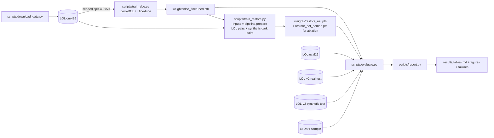

# System architecture

Every box below is a function in the code; file and function names are given so the diagram can be checked against the source. Live system: [lumina-t76.vercel.app](https://lumina-t76.vercel.app/) (website) → Hugging Face Space (engine).

```mermaid
flowchart TD
    U([User: phone / laptop browser]) -->|LUMINA web app on Vercel<br/>web/index.html + ui.js + lumina.js| API["api.py restore()<br/>POST /gradio_api/call/restore<br/>validation, cap ≤2048 px (stated)"]
    U -.->|classic interface / fallback| APP["app.py — Gradio UI"]
    API --> FULL["pipeline.run_full<br/>enhance at ≤1280 px, return input size"]
    APP --> FULL
    FULL --> RUN["pipeline.run(img, method, preset, strength)<br/>for classical, dl and hybrid"]

    subgraph S1["① Classical analysis (lowlight/classical.py, lowlight/analysis.py)"]
        T["estimate_illumination<br/>max-RGB prior + guided filter → T"]
        D["diagnose<br/>brightness, noise σ (Immerkær), lighting spread,<br/>colour cast, coloured lights, contrast,<br/>sharpness, edges, colourfulness, JPEG blockiness, size"]
        PR["choose_params + solve_gamma<br/>adaptive γ, gain cap, CLAHE, WB, saturation,<br/>pre-denoise / deblock decision"]
        PD["pre_denoise<br/>chroma + 8×8-boundary deblock<br/>(blocky JPEG; noisy classical path)"]
        T --> D --> PR --> PD
    end

    subgraph S2["② Two brightening candidates"]
        RX["retinex_enhance<br/>I/T · T^γ (gain-capped)"]
        DC["Zero-DCE++ (lowlight/dce.py)<br/>fine-tuned on LOL train split"]
        QA["choose_dce_scale<br/>quality-aware curve strength<br/>(exposure error + new clipping)"]
        DC --> QA
    end

    subgraph S3["③ Adaptive fusion (pipeline.py)"]
        FW["fusion_weights<br/>exposedness × contrast ÷ amplification"]
        PB["pyramid_blend<br/>Laplacian pyramid, 5 levels"]
        HG["protect_highlights<br/>soft-knee roll-off"]
        FW --> PB --> HG
    end

    subgraph S4["④ Contrast & colour (classical.py)"]
        CL["clahe (Lab L, 16-bit)"] --> CC["colour_correct<br/>partial gray-world + saturation"]
    end

    subgraph S5["⑤ DL restoration (lowlight/restore.py)"]
        NM["noise_map<br/>σ measured after brightening × relative gain"]
        RN["RestoreNet U-Net (145k params)<br/>input: RGB + noise map → residual"]
        NM --> RN
    end

    RUN --> T
    PD --> RX & DC
    RX --> FW
    QA --> FW
    HG --> CL
    CC --> RN
    HG --> NM
    RN --> DR["⑥ detail_stage → recover_detail<br/>re-inject above-noise detail, 2-scale unsharp mask<br/>(Gaussian base, cored), halo clamp; strengths from residual noise + sharpness"]
    DR --> UI["adjust_exposure (user intent)"]
    UI --> TRF["⑦ run_full detail transfer<br/>photo's own fine band × gain, cored + structure-gated"]
    TRF --> OUT(["api.py JSON: three outputs as WebP at the input size, diagnostics labels,<br/>enhancement breakdown, explanations, no-reference checks,<br/>intermediate maps, timings, Auto-mode recommendation"])

    style S5 fill:#eef4fc,stroke:#2a78d6
    style S1 fill:#f4fbf7,stroke:#1baf7a
```

## Methods compared (same code path, different switches)

| Method | Path in `pipeline.run` |
|---|---|
| Histogram equalisation (baseline) | `classical.histogram_equalize` |
| CLAHE only (baseline) | `classical.clahe` |
| Zero-DCE++ official (baseline) | published weights, no fine-tuning |
| **Classical only** | ① (+ pre-denoise) → Retinex → highlight guard → gain-aware bilateral + guided denoise → ④ + `limit_saturation` (colourfulness ceiling, after denoising) → ⑥ adaptive detail recovery |
| **Deep learning only** | fine-tuned Zero-DCE++ alone |
| **Hybrid** | ① → ② → ③ → ④ → ⑤ → ⑥ (diagram above); every method gets ⑦ when the photo is larger than 1280 px |

Ablations (`pipeline.ABLATIONS`) switch off one stage at a time using the same function.

## Training and evaluation flow

## Deployment

Primary interface: the **LUMINA web app on Vercel** (static, `web/`, built by `web/build.mjs` with the engine URL from `LUMINA_API_BASE`), calling the engine API cross-origin. Engine: Hugging Face Space using the **Gradio SDK on free ZeroGPU hardware** (Docker and CPU Spaces now require a paid plan). Inference runs on the Space's CPU; the GPU is never requested, which avoids GPU queueing and the daily quota. A `Dockerfile` (python:3.12-slim + CPU PyTorch) is included for self-hosting. The app has no state and no database, and stores nothing. Gradio's temporary files are purged hourly (`delete_cache`), and download files after an hour.
